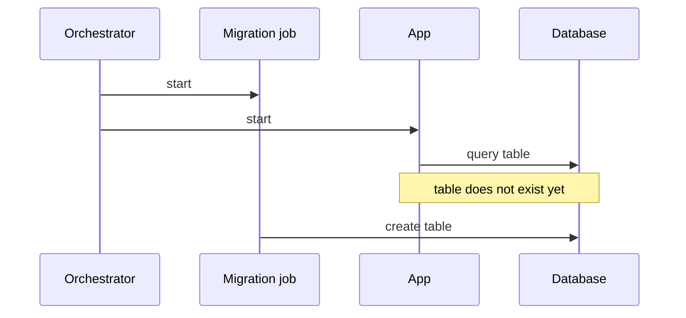

# Report template

## Contents

- Why the report is shaped this way
- Report template
- Rules for each section
- Diagrams
- Mermaid syntax rules

## Why the report is shaped this way

The reader wants to know what stops what, and in which order. A numbered list in run order, from a merge to a request, answers that directly: each step says what happens and what its failure stops, and a gap sits at the step where the app first relies on something nothing checked. The reader follows one list from top to bottom and never has to look anything up in another section.

A list reads at any width. A Mermaid diagram is shrunk to the width of the page or pane by every common Markdown renderer (Mermaid's default `useMaxWidth: true`), so a wide diagram becomes unreadable. Diagrams are therefore rare and never carry a fact the list does not also state.

## Report template

The example content below is illustrative. Replace every line with what the project actually does.

````markdown
<!-- gate-map -->
# Gate map: <project name>

<Two or three sentences: what was mapped, at which commit and on which date. Then the most important gap, in one plain sentence.>

## From merge to first request

**Merge**

1. A pull request into `main` runs typecheck, lint, tests and build in CI.
   If any of them fails, the pull request shows a failed check. Whether that blocks the merge is set outside the repository.

**Image build**

2. The image build runs `make build` only. No tests run here.
   If the build fails, no image is produced.

**Start**

3. The `db` service starts, and the `web` service waits until the database answers.
4. The app reads its settings.
   A missing setting stops the app before it takes requests.
5. The app connects to the database once.
   If that fails, the app stops.
6. The app starts taking requests.

   > **Gap:** nothing applies the migrations before this step. On a fresh database, the first request that touches a new table fails.

**Each request**

7. A request without a valid session is turned away with 401 before any handler runs.
8. The first checkout uses the payment provider key.

   > **Gap:** the key is not checked at start. A wrong key shows up as a failed checkout, not as an app that refuses to start.

## What can break

### The app takes requests before the migrations run

<Two to four sentences: how it happens, what a user or a developer sees, and what is missing for it not to happen.>

### A wrong payment key shows up only at the first checkout

<Same.>

## Also noted

- The coverage job is allowed to fail, so a drop in coverage does not block a merge.

## Not visible from the repository

- Whether the CI checks must pass before a merge into `main`: the branch protection settings on the hosting service.
- Which commit the deployed image is built from: the pipeline that publishes images.

<details>
<summary>Evidence</summary>

Commit <sha>, <date>. <Uncommitted changes, if any.>

**Where each step is defined**

1. `ci/pipeline.yml:12-30`
2. `Dockerfile:18`
3. `compose.yaml:30-44`

**Checked and ruled out**

- The `web` service starting before the database answers: ruled out, it waits for the database health check (`compose.yaml:40`).

**Not read**

- `worker/start.sh`: could add a migration step before the app starts.

</details>
````

## Rules for each section

**Opening.**
- Two or three sentences. The last one names the most important gap in plain words. If there is none, it says that nothing found can break in the files that were read.
- If the user narrowed the scope, or a stage does not exist in this project, say so here.

**From merge to first request.**
- One numbered list in run order. The numbering continues across stages, so the evidence block can refer to each step by its number.
- A bold line names each stage: Merge, Image build, Deploy, Start, Each request. Use the stages the project has and drop the others.
- Each step has a first line saying what happens and, if the step contains a check, a second line saying what its failure stops. A step with no check, such as "the app starts taking requests", has no second line.
- Checks that run together and stop the same thing share one step: "The app checks its settings, its plugin list and its routes. Any failure stops the app."
- A gap is a quote block under the step where the app first relies on the thing nothing checked. It starts with **Gap:** and has one or two sentences: what is not checked, and what happens because of it.
- Only gaps from the "What can break" section are marked in the list.

**What can break.**
- One heading per gap marked in the list, worst consequence first. The heading says what happens, in the same words as the gap mark.
- Two to four sentences under each heading.
- If nothing qualifies, write: "Nothing found that can break this way in the files that were read."

**Also noted** and **Not visible from the repository.**
- One line each. Leave a section out when it has no line.

**Evidence.**
- One collapsed `<details>` block, closed by default.
- Leave a blank line after `<summary>…</summary>` and before `</details>`, or the Markdown inside is not rendered (GitLab `doc/user/markdown.md`, collapsible sections).
- "Where each step is defined" maps step numbers to `file:line`.
- "Checked and ruled out" has one plain sentence per ruled-out gap, with its `file:line`.
- "Not read" lists only files that could change something said above, and what they could change.
- Cite the documentation page for any tool behaviour a step relies on, next to that step's location.

## Diagrams

The numbered list is the map. Draw a diagram only when a gap is about two things running at the same time, such as a migration job and the app starting together, where a sequence diagram shows the overlap better than a list.

Then draw one `sequenceDiagram` with at most 4 participants and about 10 messages, under that gap's heading in "What can break". Every message must also be stated in the text, because on a phone the diagram renders too small to read. Give it an `accTitle` and an `accDescr` line (source: https://github.com/mermaid-js/mermaid/blob/develop/packages/mermaid/src/docs/config/accessibility.md).



If `mmdc` is installed, render the diagram and read the `max-width` in the SVG's `style` attribute; that is its natural width in px. Split or drop a diagram wider than about 1,100 px. Do not set `useMaxWidth: false`; the diagram then overflows its pane instead of shrinking.

## Mermaid syntax rules

Source: https://mermaid.js.org/syntax/sequenceDiagram.html.

- In message text, write a semicolon as `#59;`; a bare semicolon ends the statement.
- Participant aliases are plain letters and digits (`O`, `DB`); the display name goes after `as`.
- Keep each Mermaid block under 2,000 characters. GitLab does not draw a longer block until the reader clicks through a performance warning (`render_sandboxed_mermaid.js`, `MAX_CHAR_LIMIT`).
- Do not use features marked beta or experimental in the Mermaid docs.
